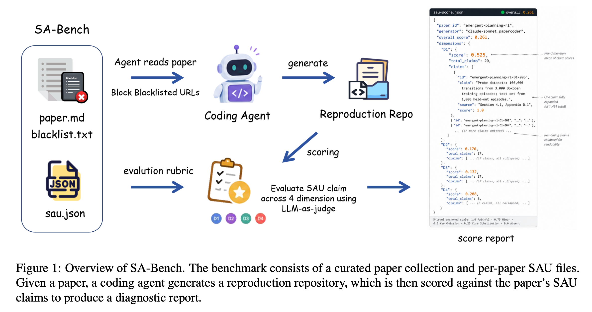
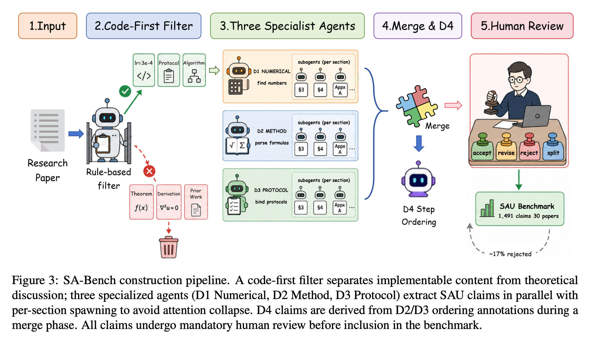

# SA-Bench: Evaluating Semantic Alignment in LLM-Based Paper Reproduction

<p align="center">
  <a href="https://arxiv.org/abs/2608.24252"></a>&nbsp;&nbsp;&nbsp;
  <a href="https://huggingface.co/datasets/kernel-14/SemanticAlign-Bench"></a>&nbsp;&nbsp;&nbsp;
  <a href="https://github.com/kernel-14/SA-Bench"></a>
</p>

## Overview

LLM agents can generate paper-reproduction code that runs while silently departing from the paper's scientific specification. SA-Bench measures this **semantic drift**: the gap between the methods, numerical settings, experimental protocols, and procedures described in a paper and those implemented in an agent-generated repository.

SA-Bench provides 1,491 atomic, verifiable **Semantic Alignment Units (SAUs)** from 30 ICLR, ICML, and NeurIPS 2025 papers across five ML domains. The benchmark scores generated repositories along four dimensions: numerical precision (D1), methods and algorithms (D2), experimental protocols (D3), and procedure ordering (D4). It includes the annotations, an evaluation pipeline, and reference runs for 12 generator configurations.



## Benchmark Construction

Each source paper first passes through a code-first filter that retains implementable content and discards theoretical discussion, derivations, and prior-work material. Three specialist agents then extract D1 numerical settings, D2 methods, and D3 experimental protocols in parallel at the section level. The merge stage derives D4 ordering constraints from the D2/D3 annotations, and human review verifies every claim before its inclusion in the benchmark.



## Quick Start

### 1. Install the scorer

```bash
pip install -e .
```

SA-Bench requires Python 3.10 or later.

### 2. Download the dataset

```bash
hf download kernel-14/SemanticAlign-Bench \
  --repo-type dataset \
  --local-dir ./data
```

### 3. Score a generated repository

```bash
sau-score \
  --paper adjoint-matching \
  --repo /path/to/generated/repo \
  --data-dir data/papers \
  --model deepseek-v4-pro \
  --api-key $OPENAI_API_KEY \
  --base-url $OPENAI_BASE_URL
```

To score all papers, provide a directory containing one generated repository per paper:

```bash
sau-score \
  --paper all \
  --repo-root /path/to/generated_repos \
  --data-dir data/papers \
  --model deepseek-v4-pro \
  --output results.json \
  --workers 4
```

Use `--dim D1`, `--dim D2`, `--dim D3`, or `--dim D4` to score one diagnostic dimension. Use `--no-llm-judge` for deterministic evidence-based scoring without an LLM judge.

## Results

We evaluate 12 generator configurations: four models paired with BasicAgent, PaperCoder, and OpenHands across all 30 papers, for 360 paper-level evaluations.

| Scaffold | Claude Sonnet | DeepSeek | Gemini Flash | GPT-4o |
| --- | ---: | ---: | ---: | ---: |
| BasicAgent | 0.272 | 0.268 | 0.150 | 0.081 |
| PaperCoder | **0.301** | 0.241 | 0.256 | 0.198 |
| OpenHands | 0.277 | 0.282 | 0.243 | 0.082 |

The strongest configuration, Claude Sonnet with PaperCoder, reaches 0.301 mean SAU score; the overall mean is 0.221. Model choice produces a 2.35x range in performance, compared with a 1.15x range across scaffolds. D3 experimental protocols remain the central bottleneck, with a 0.7% full-mark rate. Among 7,034 zero-scored claims, implementation mismatch accounts for 40.8% and stubs or placeholders account for 16.2%, showing that scientific reproduction requires explicit verification of paper specifications throughout generation.

| Dimension | SAUs | Mean score | Full-mark rate | Zero rate |
| --- | ---: | ---: | ---: | ---: |
| D1: Numerical Precision | 523 | 0.290 | 9.7% | 39.6% |
| D2: Formulas / Algorithms | 503 | 0.244 | 5.4% | 35.8% |
| D3: Experiment Protocols | 300 | 0.160 | 0.7% | 44.8% |
| D4: Pipelines / Procedures | 165 | 0.190 | 0.9% | 33.7% |

## Repository Structure

```text
SemanticAlign-Bench/
├── sa_bench/                  # Python SDK and SAU scoring CLI
│   ├── scorer.py              # Public SAUScorer API
│   ├── pipeline.py            # Scoring orchestration
│   ├── judge.py               # Dimension-specific LLM judge
│   ├── index.py               # Repository indexing and code search
│   └── prompts/               # D1-D4 judge prompts
├── baselines/                 # BasicAgent, PaperCoder, and OpenHands scaffolds
├── experiments/               # Reference generation runs and result artifacts
├── figure/                    # README and paper figures
├── HF_DATASET_CARD_README.md  # Hugging Face dataset card
└── pyproject.toml             # Package metadata and CLI entry point
```

## Citation

```bibtex
@article{hu2026sabench,
  title         = {SA-Bench: Evaluating Semantic Alignment in LLM-Based Paper Reproduction},
  author        = {Hu, Xue and Pan, Zewei and Su, Zeli and Liu, Zhou and Zhang, Wentao},
  journal       = {arXiv preprint arXiv:2608.24252},
  year          = {2026},
  url           = {https://arxiv.org/abs/2608.24252}
}
```

Code is released under the MIT License. Dataset annotations are released under CC-BY-4.0; source papers retain their original licenses.
